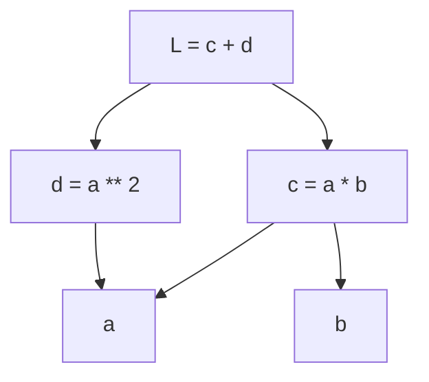

# Autograd: Design Notes

> Code: [`src/gptlab/autograd.py`](../src/gptlab/autograd.py)
> Tests: [`tests/gptlab/test_autograd.py`](../tests/gptlab/test_autograd.py)

---

## Contents

- [Words in this document](#words-in-this-document)
- [1. The problem](#1-the-problem)
- [2. The Node](#2-the-node)
- [3. The graph](#3-the-graph)
- [4. The propagate function](#4-the-propagate-function)
- [5. Accumulate the gradients](#5-accumulate-the-gradients)
- [6. The six primitives](#6-the-six-primitives)
- [7. Derived operators](#7-derived-operators)
- [8. Topological order](#8-topological-order)
- [9. The backward pass](#9-the-backward-pass)
- [10. Check the gradients with numbers](#10-check-the-gradients-with-numbers)


## Words in this document

The text uses plain words for the attributes of the node class. This table
gives the code name for each word:

| Word in this document | Attribute in the code |
|-----------------------|-----------------------|
| forward value         | `forward_val`         |
| gradient slot         | `gradient`            |
| children              | `children`            |
| propagate function    | `propagate`           |

## 1. The problem

Training changes the weights of a model to decrease a loss function. To know
the direction of the change for a weight, we must know the derivative of the
loss with respect to that weight.

In pure Python, a weight is a float. A float keeps no record of its history.
Thus, we must make a data structure.

## 2. The Node

> Code: `Node.__init__`, `Node.__repr__`
> Tests: group 1 (leaf construction)

The loss is one number. It is the last result of a long chain of operations:

weights -> embeddings -> attention -> MLP -> logits -> softmax -> loss

To calculate the derivative of the loss with respect to a weight in the chain,
we use the **chain rule**. For each link in the chain, the chain rule must
know two things: the operation that made the link, and the inputs to that
operation.

Thus, we make a node class. Each scalar in the model is a node. Each node
holds these fields:

| Field              | Attribute     | Purpose                                                     |
| ------------------ | ------------- | ----------------------------------------------------------- |
| forward value      | `forward_val` | the number computed in the forward pass                     |
| gradient slot      | `gradient`    | dL/d(this value), filled in during backprop, starts at zero |
| children           | `children`    | pointers to the values that produced this one               |
| propagate function | `propagate`   | given this node's gradient, push gradient to children       |

Important: this applies to **each** value in the forward pass, not only to
the weights. Intermediate results (the output of a multiply, an attention
score, a softmax probability) must also keep their history. The path from
the loss back to a weight goes through them.

A node that is made with a forward value only is a **leaf**. It has no
children. Its propagate function does nothing. The weights are leaves.

`__repr__` shows the forward value and the gradient slot. It shows nothing
else. The children and the propagate function are not useful in a printout.

## 3. The graph

> Code: `Node.children`
> Tests: group 3 (graph construction)

A weight does not connect directly to another weight. A weight connects to
the value that it helped to make. That value connects to the next value, and
so on, up to the loss.

- The result is a **directed acyclic graph** (DAG). The values are the
  nodes. The operations are the edges.
- The **loss** is the root.
- A node's **children** are the values that were the inputs to the operation
  that made it.
- The **weights** are leaves. They have no children. These leaves are the
  values that we can adjust.
- All other nodes are intermediate results.

We draw the graph with the loss at the top and the weights at the bottom. The
edges point down, from each node to its children. This is the opposite of
the direction in which the values were computed: a child exists before its
parent, because the inputs are computed first. Keep this picture in mind
when you read "child" and "parent" in this document.

This is the graph of `L = a * b + a ** 2`. Each arrow points from a node to
one of its children. The node `a` is a child of `c` and also a child of `d`.
Test group 6 uses this graph.



We do not make the graph before the forward pass. The forward pass makes the
graph **as a side effect**: each `+` and each `*` on node objects makes a new
node. The new node records its children. Thus, we must overload the arithmetic
operators of the node class to do this record. Sections 6 and 7 show how.

## 4. The propagate function

> Code: `Node.propagate`
> Tests: no group of its own. Groups 4 and 6 call it.

Backprop comes to a node `c` with the value `dL/dc`. The node must compute
`dL/d(child)` for each child and send it to that child. The chain rule
gives:

```
dL/d(child) = dL/dc * dc/d(child)
```

The second factor, `dc/d(child)`, is the **local derivative**. It depends only
on the operation that made `c`.

### Where the derivative logic lives

The computation occurs **at `c`**, not at the children. `c` knows the
operation that made it. `c` knows each child. `c` receives the incoming
gradient. A child knows none of these things. If a child had to compute its
own gradient, it would have to know each operation that it was part of.

Thus, each node carries a small function: "given my gradient, update the
gradients of my children." In the code, this is the `propagate` attribute.
Addition makes one version of this function. Multiplication makes a
different version. The generic backward pass calls these functions in the
correct sequence. It does not have to know the operation of any node.

The function takes one argument: the gradient of its own node. The backward
pass reads that gradient from the node and passes it in. Thus, the function
does not need a reference to the node that carries it. We can write the
function before we make that node, and pass it to the constructor. A leaf
carries a function that does nothing.

Each new operation that the model needs (exponent, log, power, a
nonlinearity, ...) is one more local derivative. We package each one in the
same way.

## 5. Accumulate the gradients

> Code: the `+=` in each propagate function
> Tests: group 5 (accumulation across consumers)

One value can be the input to more than one operation. If weight `w` is used
two times, `c = w * x` and `d = w * y`, then `c` and `d` will each send a
gradient to `w`. The true gradient is the **sum** of all paths (multivariable
chain rule):

```
dL/dw = (contribution from c) + (contribution from d)
```

Thus, each propagate function **adds** to the gradient slot of a child. It
does not replace the value. In the code, this is `+=`. Section 9 says who
sets the slots back to zero.

## 6. The six primitives

> Code: `Node.__add__`, `Node.__mul__`, `Node.__pow__`, `Node.exp`,
> `Node.log`, `Node.relu`
> Tests: group 4 (local derivatives in isolation), group 7 (numeric check)

Six operations have a propagate function of their own. We call them
**primitives**. All other operations are made from these six (section 7).

Each primitive does three things:

1. Compute the forward value.
2. Write a propagate function that holds the local derivative.
3. Return a new node with the forward value, the children, and the function.

Python has no operator for `exp`, `log`, or `relu`. Thus, they are named
methods, not dunder methods.

In the text below, `a` is `self`, `b` is `other`, and `c` is the node that
the method returns. Each subsection shows the body of the propagate function
as it is in the code.

### 6.1 Floats become leaf nodes

Inside `__add__` and `__mul__`, `other` can be a float. A float has no
forward value, no gradient slot, and no children. The propagate function of
the output node will write to `other.gradient`. This fails on a float.

Thus, the first line of each binary primitive wraps the float:

```python
other = other if isinstance(other, Node) else Node(other)
```

The wrapped float is a **leaf**. It has no children. It gets a gradient slot
that nothing reads. We accept this small waste. The alternative is a second
code path for floats in each primitive and in each propagate function.

### 6.2 Addition: `c = a + b`

- `dc/da = 1`, `dc/db = 1`
- `c` sends `dL/dc` to `a` and to `b` with no change.
- The values of `a` and `b` are not necessary.

```python
def propagate(g: float) -> None:
    self.gradient += g
    other.gradient += g
```

### 6.3 Multiplication: `c = a * b`

- `dc/da = b`, `dc/db = a`
- `c` sends `dL/dc * b` to `a`. `c` sends `dL/dc * a` to `b`.
- `c` must keep a reference to each child. `a` alone does not know the
  value of `b`.

```python
def propagate(g: float) -> None:
    self.gradient += g * other.forward_val
    other.gradient += g * self.forward_val
```

### 6.4 Power: `c = a ** n`

- `n` is a plain number, not a node. It is fixed during the forward pass.
- `dc/da = n * a ** (n - 1)` (the power rule).
- `c` sends `dL/dc * n * a ** (n - 1)` to `a`. There is one child, so
  there is one send.
- `c` must keep a reference to `a` and must also keep the number `n`. `n` is
  not a child. It is not in the graph. The propagate function must capture
  it in some other way. In the code, `n` is the `exponent` parameter of
  `__pow__`. The function reads it from the enclosing scope.
- Example: `c = a ** 2` with `a = 3`. Then `dc/da = 2 * 3 = 6`.

```python
def propagate(g: float) -> None:
    self.gradient += g * exponent * self.forward_val ** (exponent - 1)
```

### 6.5 Exponent: `c = exp(a)`

- `dc/da = exp(a)`. This is the value of `c` itself.
- `c` sends `dL/dc * c` to `a`.
- The propagate function needs only the forward value of `c`. The forward
  pass already computed it. Nothing is computed twice. In the code, the
  forward value is held in `result` before the function is written.
- Softmax needs this: `p_i = exp(x_i) / sum_j exp(x_j)`. The sum is repeated
  `+`. The division is `*` with `** -1`. Only `exp` is new.
- `exp` of a large value overflows. Softmax gives the same `p_i` when the
  same number is subtracted from each `x_i`. Subtract the largest `x_i` as a
  plain float. It is not a node. No gradient flows through it. This is exact,
  not an approximation: the derivative of softmax with respect to that shift
  is zero.

```python
result = math.exp(self.forward_val)


def propagate(g: float) -> None:
    self.gradient += g * result
```

### 6.6 Logarithm: `c = log(a)`

- `dc/da = 1 / a`
- `c` sends `dL/dc / a` to `a`.
- The propagate function needs the forward value of `a`.
- Cross-entropy loss needs this: `loss = -log(p_target)`.
- When `p_target` is near zero, `1 / a` is very large. A very large gradient
  here means the model is confidently wrong. If a gradient becomes `inf` or
  `nan`, look here first.

```python
def propagate(g: float) -> None:
    self.gradient += g / self.forward_val
```

### 6.7 ReLU: `c = max(0, a)`

- `dc/da = 1` if `a > 0`, else `0`.
- `c` sends `dL/dc` to `a` when `a > 0`. It sends nothing when `a <= 0`.
- At `a == 0` the derivative is not defined. We choose `0`. A float lands
  on exactly `0` almost never, so the choice has no effect in practice.
- The MLP clamps against the constant `0`.
- The propagate function needs the forward value of `a`. The test `c > 0`
  gives the same answer, so the forward value of `c` works too.

```python
def propagate(g: float) -> None:
    if self.forward_val > 0:
        self.gradient += g
```

## 7. Derived operators

> Code: `Node.__radd__`, `Node.__rmul__`, `Node.__neg__`, `Node.__sub__`,
> `Node.__rsub__`, `Node.__truediv__`, `Node.__rtruediv__`
> Tests: group 2 (forward values for every operator)

The forward pass makes the graph through arithmetic on node objects. Python
calls a method on the node class for each operator. We write these methods.
Python does not know which attribute to add or multiply. The body of the
method tells it.

### How Python chooses the method

1. Python looks at the left operand first.
2. For `a + 2.0`, the left operand is a node. Python calls `a.__add__(2.0)`.
3. For `2.0 + a`, the left operand is a float. Python calls
   `float.__add__(2.0, a)`. The float does not know the node class. It
   returns `NotImplemented`.
4. Python then calls the **reflected** method on the right operand:
   `a.__radd__(2.0)`. The `r` means the operands are in the other order.

### Six primitives, seven combinations

Only the six primitives of section 6 have propagate functions. The other
operators are built from these. Each combination makes one or more nodes in
the graph, each with its own children and propagate function.

| Expression | Method         | Body                            |
|------------|----------------|---------------------------------|
| `a + b`    | `__add__`      | primitive                       |
| `a * b`    | `__mul__`      | primitive                       |
| `a ** 2`   | `__pow__`      | primitive, number exponent only |
| `a.exp()`  | `exp`          | primitive                       |
| `a.log()`  | `log`          | primitive                       |
| `a.relu()` | `relu`         | primitive                       |
| `2.0 + a`  | `__radd__`     | `self + other`                  |
| `2.0 * a`  | `__rmul__`     | `self * other`                  |
| `-a`       | `__neg__`      | `self * -1`                     |
| `a - b`    | `__sub__`      | `self + (-other)`               |
| `2.0 - a`  | `__rsub__`     | `(-self) + other`               |
| `a / b`    | `__truediv__`  | `self * other ** -1`            |
| `2.0 / a`  | `__rtruediv__` | `other * self ** -1`            |

Note on `__pow__`: the exponent is a plain number, not a node. A node
exponent would need a different local derivative (it includes the log of the
base). The GPT only raises values to fixed powers, so we do not build the
general case.

## 8. Topological order

> Code: `Node._topological_order`
> Tests: group 6 (`test_backward_visits_each_node_once`,
> `test_backward_survives_a_deep_chain`)

A node can send gradient to its children only when its own gradient is final.
Thus, each node that depends on a value must be processed before that value.

- Do a **post-order depth-first search** from the loss. This gives a list in
  which each node comes after all of its children (a topological order). The
  loss is last.
- **Reverse** the list. Then walk the list and call the propagate function
  of each node. The loss is now first.
- Keep a **visited set**. Then a node that is reachable by more than one path
  (for example, a weight that is used two times) is in the list exactly one
  time.

### Two jobs, two functions

The backward pass has two jobs. The first job makes the ordered list. The
second job walks the list and calls each propagate function with the
gradient of its own node. We keep the two jobs in two functions:
`_topological_order` and `backward`. The first function does not touch a
gradient slot. The second function does not look at a child. This section
covers the first function. Section 9 covers the second.

### No recursion

A recursive depth-first search is the natural way to write the first job.
We do not use it. Each recursive call uses one frame on the Python call
stack. Python stops at a fixed depth (1000 frames by default) and raises
`RecursionError`. A GPT forward pass makes a graph that is thousands of
nodes deep. A higher limit is not safe: the C stack under Python can
overflow and end the process.

Thus, we use a loop and our own stack (a plain list). The loop cannot pause
in the middle of a node the way a recursive call can. To get the post-order,
each node goes on the stack two times, with a tag:

1. Push the root with the tag `expand`.
2. Pop one entry. If the tag is `append`, add the node to the list. Go to
   step 2.
3. The tag is `expand`. If the node is in the visited set, drop it. Go to
   step 2.
4. Add the node to the visited set.
5. Push the same node again with the tag `append`.
6. Push each child with the tag `expand`.
7. Go to step 2.

The stack is last-in, first-out. The children go on after the `append` entry,
so they come off before it. Each child is fully processed before the
`append` entry of the node comes back to the top. This reproduces the pause
of the recursive version. The root is appended last.

In the code, the tag has the type `Literal["expand", "append"]`. The type
checker then rejects any other string.

The sibling order can differ from the recursive version. This does not
matter. Any order in which each node comes after all nodes that it depends
on is correct.

## 9. The backward pass

> Code: `Node.backward`
> Tests: group 6 (the full backward pass)

`backward` does the second job of section 8:

1. Set the gradient slot of the root to `1.0`. This is `dL/dL`.
2. Get the ordered list from `_topological_order`.
3. Walk the list in reverse. For each node, call its propagate function with
   the value of its own gradient slot.

When step 3 reaches a node, each node that depends on it has already sent
its contribution. Thus, the gradient slot of the node is final before the
node sends anything to its children.

Training has three stages: the forward pass, the backward pass, and the
optimizer step. This document covers the first two. The two rules below are 
the contract between `backward` and the optimizer.

### Forward values stay frozen

Each node has two numbers: the forward value and the gradient slot. Backprop
writes only to the gradient slot. It does not change the forward value.

This rule must be strict for this reason: the local derivative of a
multiplication is the *forward value of the other child*. If a forward value
changed during the backward pass, each later node that reads it would compute
its gradient from a number that the forward pass did not use. All gradients
are defined with respect to the forward pass as it occurred. Thus, forward
values must stay frozen until the full backward pass is complete.

The weight update is a **separate pass**. It is the task of the optimizer.

### Gradient slots are not zeroed

The propagate functions use `+=`. They add to a gradient slot. They do not
replace it. The backward pass does not clear the slots before the walk.
Thus, a second call to `backward()` on the same graph adds the same
contributions a second time.

This is a decision. The optimizer owns the zeroing. The backward pass does
one job only: fill the slots from the graph as it is. A test holds this
decision in place.

## 10. Check the gradients with numbers

> Code: none
> Tests: group 7 (numeric gradient check)

The tests in groups 4 and 6 compare the code with derivatives that we
computed by hand. If the hand computation and the code have the same error,
the tests pass and the error stays. Group 7 removes this risk. It compares
the gradient from `backward` with a numeric estimate that does not use the
chain rule at all.

The estimate is the **central finite difference**:

```
dL/dx ~ (L(x + h) - L(x - h)) / (2h)
```

- The test computes the loss two times with plain floats: once with `x`
  moved up by `h`, once with `x` moved down by `h`. No node is involved.
- The error of this estimate is proportional to `h ** 2`. With `h = 1e-6`,
  the error is near `1e-12`. Thus, a tolerance of `1e-6` is honest.
- The first test loss uses every operator of sections 6 and 7, with floats
  on both sides. The second test loss is a two-class softmax cross-entropy
  plus a ReLU term, in the shape that the model will use them.
- The sample points keep `a * b` away from zero. Thus, the ReLU kink is not
  hit. The derivative is not defined there, and a numeric estimate across
  the kink is not meaningful.
