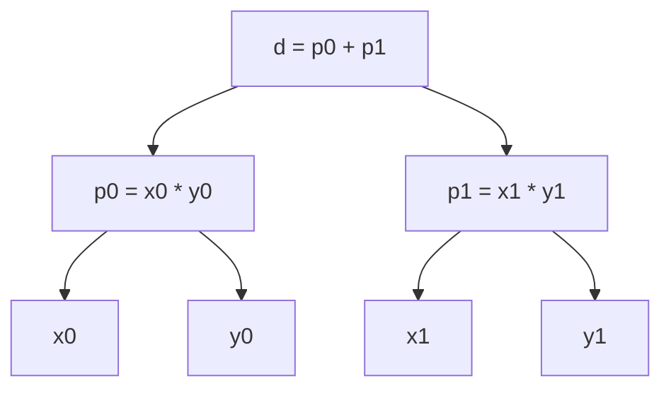

# Layers: Design Notes

> Code: [`src/gptlab/layers.py`](../src/gptlab/layers.py)
> Tests: [`tests/gptlab/test_layers.py`](../tests/gptlab/test_layers.py)

---

## Contents

- [1. The problem](#1-the-problem)
- [2. Vectors and matrices as lists](#2-vectors-and-matrices-as-lists)
- [3. Dot](#3-dot)
- [4. Linear](#4-linear)
- [5. Softmax, with the shift](#5-softmax-with-the-shift)
- [6. RMSNorm](#6-rmsnorm)
- [7. Transpose](#7-transpose)
- [8. Check the gradients with numbers](#8-check-the-gradients-with-numbers)


## 1. The problem

The model is a short chain of operations, repeated for each layer and for
each position. Three of these operations take a vector, return a vector, and
hold no logic of their own:

- A dot product of the vector with each row of a matrix. This is `linear`.
- A map from a vector of scores to a probability distribution. This is
  `softmax`.
- A division of a vector by its own scale. This is `rmsnorm`.

Two more are smaller:

- A dot product of two vectors. This is `dot`. It returns one node. It is
  the loop inside `linear`, and attention calls it on its own for each
  score.
- A swap of the rows and columns of a matrix. This is `transpose`. It
  returns a matrix and makes no node.

Each one is called from at least one place in the model:

| Function    | Called by                                                                                                                      |
|-------------|--------------------------------------------------------------------------------------------------------------------------------|
| `linear`    | Attention, for the query, key, value, and output projections. The MLP, for both of its layers. The model, for the output head. |
| `softmax`   | Attention, over the scores of one position. The loss, over the vocabulary, before `log`.                                       |
| `rmsnorm`   | The model, after the embeddings, before each attention block, before each MLP block, and after the last block.                 |
| `dot`       | `linear`, once per row. Attention, for the score of one query against one key.                                                 |
| `transpose` | Attention, to turn the values of the positions read so far into the rows that `linear` expects.                                |

The two callers of `softmax` give it different inputs. In attention, the
vector has one score per position up to the current one, so its length
changes with the position. In the loss, the vector has one logit per token
in the vocabulary, and the next operation is `log` of one element.

These functions are one module for two reasons. Most of them have more
than one caller. The rest are too small for a module of their own, and too
easy to get wrong inline. One module and one test file prove each function one time. The
callers then build on functions that are already tested.

Each function is a pure function. It takes its inputs as arguments, makes
nodes, and returns them. It stores nothing between calls. The weight matrix
of `linear` belongs to the model. The model makes it one time, holds it in
the parameter list, and passes it in on each call. The optimizer never reads
this module. It walks the parameter list of the model, and the gradients it
finds there were sent by the product nodes of section 3.

## 2. Vectors and matrices as lists

> Code: `Vector`, `Matrix`
> Tests: no group of its own. Every group uses them.

A layer takes a list of numbers and returns a list of numbers. In this
project each number is a node. Thus:

- A **vector** is `list[Node]`.
- A **matrix** is `list[Vector]`, which is `list[list[Node]]`. It is a list
  of rows. Each row is a vector.

`Vector` and `Matrix` are type aliases. The type checker uses them to find
a vector passed where a matrix is expected, or a float passed where a node
is expected. At run time they are plain lists.

Shape convention for a matrix `w`:

- `w[i]` is row `i`.
- `len(w)` is the number of rows. For a weight matrix, this is the number
  of outputs.
- `len(w[0])` is the number of columns. For a weight matrix, this is the
  number of inputs. It must equal `len(x)`.

A row is one output because `linear` takes the dot product of `x` with one
row at a time. If a column were one output, the loop would need an index
into every row.

The code does not check shapes before it starts. The model controls its own
shapes. The one guard is in `dot`, and section 3 describes it. `linear`
passes each row through it, so a row that is longer or shorter than `x`
raises `ValueError`.

The running sums use `+=`. The node class has no **in-place** add, so Python
runs `total = total + item` and binds the name to a new node. No node is
changed after it is made. `+=` is a shorter spelling of the same thing.

## 3. Dot

> Code: `dot`
> Tests: group 1 (dot)

The dot product of two vectors of the same length is the sum of the
products of their elements:

```
d = x[0] * y[0] + x[1] * y[1] + ... + x[n-1] * y[n-1]
```

Each `*` makes a product node. Each `+` makes a sum node. The graph is a
chain of additions. Each addition has one product as a child. This is the
graph of `d = x0 * y0 + x1 * y1`:



This is the one place in the module that reduces a vector to a number.
`linear` calls it one time per row. Attention calls it one time per score.
Both callers get the same graph from the same tested loop.

### Why a loop and not `sum`

Python has a builtin `sum`. It is not used here. The reason is in how `sum`
starts.

`sum(items)` starts from the integer `0` and computes `0 + items[0]`. The
left operand is an `int`. Python asks `int.__add__` first. It does not know
the node class, so it returns `NotImplemented`. Python then asks the right
operand: `items[0].__radd__(0)`. That calls `__add__`, and the first line of
`__add__` wraps `0` in a new leaf node.

The result is one extra node per dot product. Its forward value equals the
first product. Its children are the first product and a leaf with value
`0`.

This extra node is **harmless**:

- Addition passes the gradient through unchanged. The first product receives
  the same gradient with or without the extra node.
- The leaf with value `0` also receives a gradient. No code reads it.

The extra node is also **waste**. It is one unused node per dot product,
and one more thing for a reader to explain. Thus, the code starts from the
first product and adds the rest in a loop. The graph then holds only the
operations that the formula names.

One consequence: a seeded loop needs at least one element. An empty vector
raises at the seed. The sums in `softmax` and `rmsnorm` are seeded in the
same way. Thus, every function in this module that makes nodes needs a
vector with at least one element.

### The guard

The `zip` over `x` and `y` has `strict=True`. By default, `zip` stops at
the shorter list and raises nothing. Without the flag, two vectors of
different lengths would give a wrong number and no error. With the flag, it
raises `ValueError`. The flag makes no node, so the graph is the same.

### The backward pass through dot

Nothing in `dot` is new to the autograd engine. The chain rule follows from
sections 6.2 and 6.3 of `docs/AUTOGRAD.md`:

- Each `+` sends the gradient of `d` unchanged to both of its children.
  Thus, every product in the chain receives the full gradient of `d`.
- Each product `x[j] * y[j]` sends `g * y[j]` to `x[j]` and `g * x[j]` to
  `y[j]`.

## 4. Linear

> Code: `linear`
> Tests: group 2 (linear)

A linear layer multiplies a vector by a matrix. Output `i` is the dot
product of `x` with row `i` of `w`:

```
y[i] = dot(x=x, y=w[i])
```

The code is one comprehension over the rows of `w`. There is one output per
row. The comprehension makes no node of its own. `dot` makes every node in
the graph of `linear`. Thus, the graph of one output is the graph of
section 3, and the guard of section 3 checks each row against `x`.

There is no bias term. A bias adds one parameter, one leaf, and one sum node
per output. The base model trains without it, so the baseline keeps the
smaller graph. A bias is a later lab swap: add it, train, and compare.

### The backward pass through linear

Section 3 says what one dot product sends to its inputs. `linear` adds one
thing: `x[j]` is a child of one product in **every** row. Its gradient slot
accumulates one term per row, `g[i] * w[i][j]` for each output `i`. This is
the `+=` of section 5 of `docs/AUTOGRAD.md`. Each weight `w[i][j]` is a
child of one product only, so it receives `g[i] * x[j]` and nothing else.

## 5. Softmax, with the shift

> Code: `softmax`
> Tests: group 3 (softmax)

Softmax turns a vector of logits into a probability distribution:

```
p[i] = exp(x[i]) / (exp(x[0]) + exp(x[1]) + ... + exp(x[n-1]))
```

Each `p[i]` is positive and the `p[i]` sum to 1. The code has three stages:
shift, exponentiate, normalize.

### The shift

`exp` of a large float overflows. `math.exp(1000.0)` raises an error. The
logits of an untrained model are small, but nothing keeps them small during
training. Thus, the code subtracts the largest logit from every logit before
it calls `exp`. The largest exponent is then `exp(0) = 1`, and nothing
overflows.

The shift does not change the output. Subtract the same number `m` from each
logit. Each `exp(x[i] - m)` is `exp(x[i]) * exp(-m)`. The factor `exp(-m)`
appears in the numerator and in every term of the denominator. It cancels.
The `p[i]` are the same for any `m`.

The shift is a **plain float**, read from the forward values of the logits.
It is not a node. The derivative of softmax with respect to `m` is zero, so
no gradient needs to flow through it.

### What the shift costs in the graph

`logit - max_logit` is a node minus a float. `__sub__` computes
`logit + -max_logit`. The unary minus acts on the float, so it stays a
float. Then `__add__` wraps it in a leaf node. The result has two children:
`logit`, and a leaf that holds `-max_logit`.

In the backward pass, addition sends the full gradient to both children.
Thus:

- `logit` receives the same gradient that it would receive with no shift.
  The shift is **exact**.
- The leaf receives a gradient that no code reads. The leaf is not a
  parameter, it is not returned, and the next forward pass makes a new
  shift from the new logits. The shift is **free**.

This leaf is not the same waste as the `Node(forward_val=0)` of section 3. That zero
was never part of the dot product. It came from how builtin `sum` starts,
and a different loop removed it. The shift is part of the formula that the
code computes. The node class combines nodes with nodes, so a float operand
must become a leaf. The only way to remove it is to change the engine. The
cost is one dead leaf per logit, and the code accepts it.

### Exponentiate and normalize

Each `(logit - max_logit).exp()` is one node with one child, as in section
6.5 of `docs/AUTOGRAD.md`. The denominator is a running sum of these nodes,
seeded from the first, in the loop shape of section 3.

The division is `* ... ** -1`. The code computes `denominator ** -1`
**once** and multiplies each exponential by it. This is one power node and
`n` product nodes. The alternative `exponential / denominator` for each
output makes a new power node every time, `2n` nodes in all, and the
gradient slot of the denominator accumulates `n` equal contributions in
place of one. Both give the same gradients. The code uses the smaller graph.

## 6. RMSNorm

> Code: `rmsnorm`
> Tests: group 4 (rmsnorm)

RMSNorm divides each element of a vector by the root mean square of the
vector:

```
rms  = (mean(x ** 2) + eps) ** 0.5
y[i] = x[i] / rms
```

After the division, the root mean square of `y` is 1. The scale of the input
is gone. The direction of the input is kept. The code has the stages: square,
sum, mean, add `eps`, power, multiply.

- The squares are a comprehension. The sum is a seeded loop.
- The mean is `/ len(x)`. The count is a plain number. It becomes one leaf,
  as in section 5.
- `eps` is a plain float. It becomes one leaf.
- The root and the division are one operation: `** -0.5`. There is no
  square root primitive and no division primitive in the engine. One power
  node gives both, as section 6.4 of `docs/AUTOGRAD.md` allows.
- The power node is computed once. Each `x[i]` is multiplied by it. This
  is the same choice as the reciprocal in section 5.

There is no learned scale. In this model, every call of `rmsnorm` is
followed by a linear layer with no bias. A scale `g[i]` on `y[i]` multiplies
column `i` of that matrix, because `w[k][i] * (g[i] * y[i])` is
`(w[k][i] * g[i]) * y[i]`. The matrix can learn the same function. Thus, a
learned scale adds parameters and nodes but no new function. It can change
how fast training moves, and that is a later lab swap.

### Why `eps` is inside the root

A zero vector has `mean(x ** 2) = 0`. With `eps` outside the root, the code
would compute `0 ** -0.5`, which raises an error. With `eps` inside, the
scale is `(0 + eps) ** -0.5`, about 316 for `eps = 1e-5`. Every output is
`0 * 316 = 0`. The forward pass is finite.

The backward pass is also finite. The local derivative of the power node is
`-0.5 * eps ** -1.5`. This is large but finite. It is multiplied by the
gradient that reaches the power node, and that gradient is `g * x[i]` from
each product, which is zero. Thus, nothing reaches the mean or the squares.
Each `x[i]` receives `g * 316`. Nothing is infinite and nothing is NaN.

For a vector that is not zero, `eps` is small against the mean of the
squares and changes the result by less than the test tolerance.

### Why RMSNorm and not LayerNorm

LayerNorm subtracts the mean of the vector and then divides by the standard
deviation. It has two learned vectors: a scale and a bias. RMSNorm drops the
mean subtraction and the bias. It keeps only the division by the root mean
square.

The reasons to use it here:

- It is fewer operations. Each node is a Python object, so fewer nodes is a
  faster forward pass and a smaller graph.
- The mean subtraction is not needed for the normalization to do its job,
  which is to keep the scale of the activations in range for the layers
  that follow.

## 7. Transpose

> Code: `transpose`
> Tests: group 5 (transpose)

The transpose of a matrix swaps its rows and columns. Element `[r][c]` of
the result is element `[c][r]` of the input. A matrix with `R` rows of `C`
elements becomes a matrix with `C` rows of `R` elements.

The code is `zip(*m, strict=True)`. The star passes each row of `m` as a
separate argument to `zip`. `zip` then yields one tuple per column: the
first elements of every row, then the second elements, and so on. The
comprehension turns each tuple into a list. Thus, the result is a `Matrix`
and not a list of tuples.

### No node is made

`zip` and `list` move references. They make no node. Row `c` of the result
holds the same node objects as column `c` of `m`, in the same order. The
test in group 5 checks this with `is`, not with `==`. The graph after a
transpose is the graph before it. There is nothing for the backward pass to
do, and nothing for a gradient check to prove.

### Why attention needs it

Section 2 says that a row of a weight matrix is one output, and that
`linear` pairs the input with each row. Attention has the opposite case. It
holds the values of the positions that it has read as a matrix with one row
per **position**. It needs one output per **element**, and each output is a
weighted sum over the positions.

The rows are in the wrong direction for `linear`. A transpose turns them in
the correct direction. The weighted sum is then
`linear(x=weights, w=transpose(m=values))`. Section 2 of `docs/ATTENTION.md`
gives the full argument.

### The guard

`strict=True` raises `ValueError` if the rows do not all have the same
length. Without the flag, `zip` stops at the shortest row and discards the
end of every longer row. The result would have the wrong shape and no
error. This is the same decision as in `dot`: a wrong shape is an error,
not a wrong number.

## 8. Check the gradients with numbers

> Code: none
> Tests: group 6 (numeric gradient check)

The tests in groups 1 to 5 check the forward values. Some compare a function
with values that we computed by hand. Others check a property that must hold
for any input: the softmax sums to 1, the output of rmsnorm has unit root
mean square. Group 6 checks the gradients. It uses the method of
section 10 of `docs/AUTOGRAD.md`: compare `backward` with a central finite
difference, `(f(v + h) - f(v - h)) / (2h)`, with `h = 1e-6`.

Five points are specific to this module:

- `linear`, `softmax`, and `rmsnorm` return a vector. A gradient check
  needs a scalar. The test loss is a weighted sum of the outputs with fixed,
  distinct coefficients. A plain sum would not do. The plain sum of a
  softmax is always 1, so every gradient through it would be zero, and the
  test would prove nothing. `dot` returns one node, so it is its own loss.
- `linear` has its own case, although every node in it comes from `dot`.
  The test perturbs its float reference in `w` as well as in `x`. Thus,
  the match proves `dL/dw`, which is the number the optimizer reads. It
  also proves the accumulation across rows of section 4.
- `transpose` is not in this group. It makes no node, so it has no gradient
  of its own. Group 5 proves it by object identity instead.
- The float reference for each function is written in the test with `math`.
  It does not call the function under test. If the two share no code, they
  cannot share an error.
- Two claims from earlier sections rest on this group. The float reference
  for `softmax` has no shift, so the match in value and in gradient proves
  that the shift of section 5 is exact. The float reference for `dot` is
  the plain `sum` that section 3 rejects. Thus, the match proves that the
  seeded loop and builtin `sum` give the same gradient.

A gradient check proves that the backward pass matches the forward pass. It
does not prove that the forward pass is the right function. A forward pass
that squares each element before the multiply in `rmsnorm` passes the
gradient check and fails the hand case. The two groups of tests hold
different things in place.
